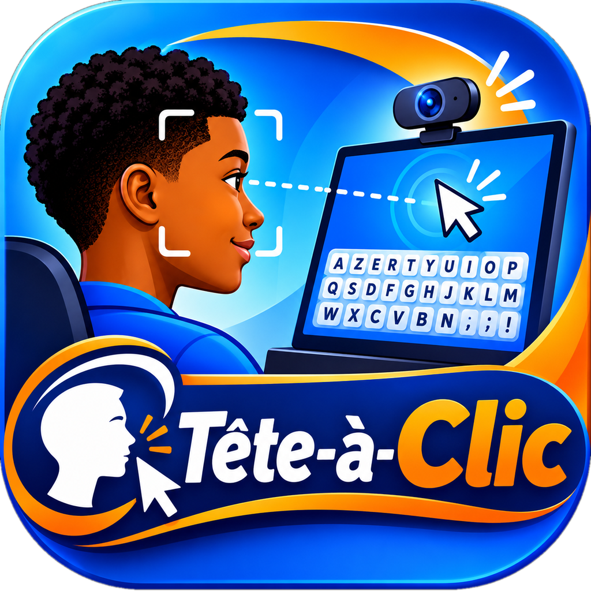

<p align="center"></p>

# Tête-à-Clic

*par **MarcDev@** · © 2026 MarcDev@. Tous droits réservés. · Contact : [marcdevfullstack@gmail.com](mailto:marcdevfullstack@gmail.com)*

**Contrôler son ordinateur avec la tête et le regard**, avec une simple webcam.

**[⬇ Télécharger l'installateur pour Windows](https://github.com/marcdevfullstack-cloud/T-te---Clic/releases/latest)**

## Le projet

### Le problème

Des milliers de personnes ne peuvent pas se servir d'une souris : paralysie, sclérose latérale amyotrophique (maladie de Charcot), myopathie, accident vasculaire cérébral, amputation, ou simplement un bras dans le plâtre. Sans souris, l'ordinateur leur est fermé, et avec lui l'écriture, les études, le travail, les démarches en ligne et les échanges avec leurs proches.

Les solutions existantes coûtent cher (des milliers d'euros pour un appareil de suivi des yeux) ou demandent un matériel spécial. Elles sont souvent en anglais, et compliquées à régler pour un aidant.

### La solution

**Tête-à-Clic transforme la webcam de l'ordinateur en souris et en clavier.** La personne tourne la tête : le curseur suit. Elle cligne longuement des yeux, ou garde la tête immobile un instant : c'est un clic. Elle lève les sourcils : clic droit. Elle ouvre la bouche et incline la tête : la page défile. Un grand clavier français à l'écran lui permet d'écrire dans n'importe quelle application : Word, un navigateur, WhatsApp, un e-mail.

Rien à acheter, rien à brancher : une webcam ordinaire suffit.

### Pour qui

- **Les personnes paralysées ou à mobilité réduite** des membres supérieurs, qui gardent le contrôle de la tête.
- **Les personnes temporairement privées de leurs mains** : fracture, opération, tendinite.
- **Les aidants, les familles, les ergothérapeutes et les établissements de santé**, qui cherchent une solution simple à installer et à régler.

### Ce qui le distingue

- **Le clic tombe là où l'on visait.** Quand on cligne des yeux, la tête bouge souvent un peu. Tête-à-Clic s'en souvient et clique là où était le curseur *juste avant* le geste.
- **Les clignements naturels sont ignorés.** Seul un clignement volontaire, plus long, déclenche un clic.
- **Un curseur stable sans être lent**, grâce au filtre « One Euro », la référence scientifique en pointage.
- **Un clavier qui écrit vraiment partout** : il ne prend jamais le focus, et son bandeau indique dans quelle fenêtre le texte va s'écrire.
- **Pensé pour l'aidant** : il reprend la main en touchant simplement la souris, et Ctrl + Alt + P met tout en pause. Des jauges en direct montrent chaque geste, pour apprendre et régler facilement.
- **Respect total de la vie privée** : tout est calculé sur l'ordinateur. Aucune image n'est enregistrée, rien n'est envoyé sur internet, aucun compte n'est nécessaire.
- **En français**, avec une voix qui annonce les actions importantes.

### Où en est le projet

Version **1.1** pour Windows 10 et 11 : pointage, clics, défilement, pause sans les mains et clavier intégré. Les prochaines étapes (prédiction de mots, phrases rapides, bouton d'appel à l'aide, version Android) sont décrites dans la [feuille de route](ROADMAP.md).

## Comment ça marche

| Geste | Action |
|---|---|
| Tourner la tête | Le curseur suit (pointage absolu, lissé contre les tremblements) |
| **Clignement long** (environ ½ seconde) | Clic gauche. Les clignements naturels sont ignorés |
| Garder le curseur **immobile** 1,2 s | Clic. Un anneau se remplit autour du curseur |
| **Lever les sourcils** | Clic droit |
| **Ouvrir la bouche**, puis lever ou baisser la tête | Défilement (molette) |
| **Fermer les yeux 2,5 s** | Pause, puis reprise, sans les mains |
| Bouton **Clavier** | Affiche le clavier Tête-à-Clic (voir ci-dessous) |

## Écrire avec la tête : le clavier Tête-à-Clic

1. **Clique d'abord dans le texte où écrire** (Word, Bloc-notes, navigateur…), par clignement ou immobilité.
2. Affiche le clavier (bouton **Clavier**). Son bandeau indique **où le texte va s'écrire**.
3. Pointe une touche et **reste immobile** (ou cligne longuement) : la lettre est tapée.
   Rester sur la même touche la **retape** après un nouveau délai : pratique pour « ll », « ss ».

- Grandes touches AZERTY, accents en accès direct (é è à ç, ê ù en mode 123), **⇧** majuscule, **Entrée**, **⌫** effacer, flèches **← →**, **123** chiffres et symboles.
- **⇅** passe le clavier en haut ou en bas de l'écran ; **✕** le masque.
- Le clavier **ne prend jamais le focus** : le texte arrive dans ta fenêtre, et non dans Tête-à-Clic. Le clavier visuel de Windows (osk.exe), lui, ignore souvent les clics simulés : c'est pourquoi Tête-à-Clic a le sien.

**Pour l'aidant :**
- **Ctrl + Alt + P** met en pause ou reprend, même hors de la fenêtre.
- **Toucher la vraie souris** suspend aussitôt le contrôle par la tête pendant 2,5 s.

**Précision du clic :** quand on cligne ou qu'on lève les sourcils, la tête bouge souvent un peu. Tête-à-Clic clique donc là où était le curseur **juste avant** le geste.

## Installation

Lance **`TeteAClic-Setup-<version>.exe`** et suis les étapes. Aucun droit administrateur n'est nécessaire, et l'application s'installe pour l'utilisateur courant.

- Il faut **Windows 10 ou 11 (64 bits)** et une **webcam**.
- Une icône sur le bureau est proposée, ainsi qu'un démarrage avec Windows (désactivé par défaut).
- Pour désinstaller : *Paramètres > Applications*. Les réglages restent dans `%LOCALAPPDATA%\TeteAClic`.
- L'installateur n'est pas encore signé. Windows peut donc afficher « Windows a protégé votre ordinateur » : clique sur **Informations complémentaires**, puis **Exécuter quand même**.

## Fabriquer l'installateur

```powershell
.venv\Scripts\activate
.\packaging\build.ps1
```

Le script lance les tests, génère l'icône et construit l'application avec PyInstaller. Il vérifie ensuite l'exécutable (`--selftest`), puis construit l'installateur avec Inno Setup 6 dans `dist\`. Pour signer, renseigne `CODESIGN_PFX` et `CODESIGN_PASSWORD`.

## Démarrage depuis le code source

```powershell
cd head_pilot
python -m venv .venv
.venv\Scripts\activate
pip install -r requirements.txt
python main.py
```

Au démarrage, **regarde le centre de l'écran 2 secondes** : c'est le recentrage. Tu peux le refaire avec le bouton **Recentrer**, par exemple après avoir changé de position.

## Réglages (dans la fenêtre, enregistrés automatiquement)

- **Sensibilité horizontale et verticale** : plus haut = petits mouvements de tête suffisent.
- **Stabilité** : plus haut = curseur plus stable, plus bas = plus réactif.
- **Gestes** : chacun s'active ou se désactive. Une jauge en direct montre l'intensité du geste et son seuil de déclenchement : utile pour apprendre.
- **Clic par immobilité** : durée de 0,6 à 2,5 s.
- **Son des clics** et **voix** (annonces de pause, de reprise et de recentrage).

## Technique

- **MediaPipe Face Landmarker** : 478 points du visage et scores des expressions (clignement, sourcils, bouche).
- **Orientation de la tête** : décalage du nez par rapport au milieu des yeux, divisé par l'écart des yeux. On suit ainsi la rotation, pas la position dans l'image.
- **Filtre « One Euro »** (Casiez et al., 2012), la référence pour le pointage : stable à l'arrêt, réactif en mouvement.
- **Anneau du curseur** : fenêtre Windows superposée, transparente pixel par pixel, que les clics traversent, rafraîchie à 60 images/s.
- **Souris** : API Windows via ctypes, en vrais pixels (compatible avec un affichage à 125 % ou 150 %).

```
tete_a_clic/
  tracker.py   visage → orientation de la tête + scores des gestes
  gestures.py  reconnaissance des gestes (logique pure, testée)
  pointer.py   tête → position du curseur, clic par immobilité (logique pure, testée)
  filters.py   filtre One Euro
  engine.py    boucle principale : caméra → gestes → souris
  mouse.py     souris et frappes clavier Windows (SendInput)
  keyboard.py  clavier Tête-à-Clic (fenêtre qui ne prend jamais le focus)
  keyboard_layout.py  disposition des touches (logique pure, testée)
  overlay.py   anneau transparent autour du curseur
  hotkey.py    raccourci Ctrl+Alt+P
  config.py    réglages enregistrés
  ui/          fenêtre (pywebview), flux vidéo local, interface web
main.py        point d'entrée (--version, --selftest)
packaging/     icône, PyInstaller, installateur Inno Setup
tests/         tests de la logique
```

Tests : `python -m unittest`

Ce que fera la version de ce soir :

La souris suit la tête : la position du nez par rapport aux yeux donne la direction, et un filtre anti-tremblement rend le curseur précis.
Clic gauche : un clignement long (environ une demi-seconde). Les clignements naturels, plus courts, sont ignorés.
Clic par immobilité : garder le curseur immobile une seconde clique. C'est le mode standard des logiciels d'accessibilité, avec un anneau de progression autour du curseur.
Clic droit : lever les sourcils.
Défilement : ouvrir la bouche, puis lever ou baisser la tête.
Pause et reprise sans les mains : fermer les yeux 2,5 secondes.
Recentrage : un bouton, ou automatique au démarrage.
Clavier visuel de Windows : un bouton, pour écrire avec la tête.
Sécurité : si quelqu'un touche la vraie souris, le contrôle par la tête s'efface aussitôt.
Panneau de contrôle dans le style de Posture Coach : vidéo, jauges des gestes, réglages de sensibilité.
